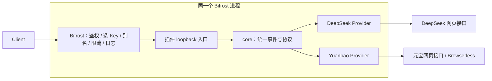

# bifrost-web-providers

> **本项目由 Qwen3.8 Max 开发**

将 `chat-base` 共用逻辑和网页端 Provider 收敛到一个 Go 项目，通过 Bifrost
原生插件加载。包含共享 core、DeepSeek 网页 Provider 与元宝网页 Provider。

## 当前状态

- core、HTTP runtime、原生插件生命周期已实现。
- Chat Completions、SSE、无状态 Responses、Models 共用同一 Provider 接口。
- 已验证 race tests、vet，以及真实 `plugin.Open` 加载、请求和卸载。
- DeepSeek、元宝已注册，具备真实 PoW / CDP 签名与合成上游回归测试。
- 完整动态 Bifrost 镜像已构建，真实网关的离线模拟上游回归已通过。
  现有静态 Bifrost 镜像不能加载 `.so`。
- 尚未用真实账号联网验收，未修改生产 Bifrost 或旧 Deno 服务。

## 结构

```text
core/             共享协议、消息、附件、工具、事件、缓存、会话与网络
pluginruntime/    配置、工厂注册、单一 loopback 入口、HTTP/SSE/Responses
providers/        DeepSeek、Yuanbao 等具体实现和唯一注册入口
plugin/           Init / GetName / Cleanup 原生插件入口
deploy/           同时构建动态 Bifrost 与插件的 Dockerfile
examples/         core-only 与迁移完成后的配置示例，无凭证
tests/            原生插件测试 Provider 和动态加载器
docs/             设计与 QwenDev 迁移交接
```

设计：[DESIGN.md](docs/DESIGN.md)。接口说明：[PROVIDER-SDK.md](docs/PROVIDER-SDK.md)。
Provider 配置与差异：[PROVIDERS.md](docs/PROVIDERS.md)。
审核记录：[REVIEW.md](docs/REVIEW.md)。迁移任务记录：[QWENDEV-HANDOFF.md](docs/QWENDEV-HANDOFF.md)。

## 请求链路



Bifrost custom provider 的 base URL 使用
`http://127.0.0.1:8792/providers/deepseek-web` 或
`http://127.0.0.1:8792/providers/yuanbao-web`，并设置
`allow_private_network: true`、`base_provider_type: openai`。
默认请求路径追加 `/v1/chat/completions`、`/v1/models`、`/v1/responses`。
Provider Key 仍由 Bifrost 管理，插件配置不保存 token/cookie。
完整配置参考 [examples/bifrost.json](examples/bifrost.json)，其中凭证使用环境变量引用。

## 验证

本机未安装 Go 时可直接使用 Docker：

```sh
scripts/check.sh
scripts/test-plugin.sh
```

已有 Go 1.27.0：

```sh
go test -race ./...
go vet ./...
```

测试不使用线上凭证、不请求真实模型。原生插件测试在动态 Go host 中加载实际 `.so`，
验证生产插件的启动/卸载与测试 Provider 的 Chat、SSE、Responses。
完整 Bifrost 网关集成另行运行（先构建镜像）：

```sh
scripts/test-gateway.sh
```

该测试在无外网容器中启动真实 Bifrost 和合成上游，验证 Chat、SSE、Responses、鉴权、
选 Key、模型权限、签名头转发和会话清理。

## 动态 Bifrost 构建

```sh
docker build -f deploy/Dockerfile -t local/bifrost-web-providers:dev .
```

基于 Bifrost `transports/v2.2.6` 对应的固定提交构建完整 UI 和动态网关。
host 与 `.so` 使用相同 Go 1.27.0、musl、CGO、build tags，并放在同一个 Go
workspace 统一解析依赖，避免包版本或 ABI 不一致。

使用 `examples/plugin-after-migration.json` 启用两个 Provider；
`examples/plugin-core-only.json` 用于仅启动插件入口。
本项目不修改现有线上 Docker Compose、数据库或 Deno 服务。

## 兼容边界

- 流式返回 content、reasoning、tool calls、citations、实际 usage；不编造 token 数。
- 普通请求和流式请求共用 `EventStream`，只发出一个最终结束标记。
- JSON 和工具参数按 JSON Schema 验证；禁止 schema 从远程或本地文件加载 `$ref`。
- 提示词工具协议支持 bracket 和随机 delimiter，能处理分隔符跨网络块。
- 附件支持 data URL、HTTP(S)，有大小上限；远程附件默认禁止私网/本地地址。
- 支持无状态 Responses 和 function tools；持久化、后台任务、
  `previous_response_id`、内置非 function tools 等能力明确拒绝。
- Provider 自己负责判定上游结束，异常 EOF/错误事件应返回错误，不能伪装成功。
- `Open`、`Next`、`Close` 和所有上游请求必须遵守 context。

仓库来源参考：[chat-base](https://github.com/WebLLmTech/chat-base)、
[deepseek-deno-api](https://github.com/WebLLmTech/deepseek-deno-api)、
[yuanbao-deno-api](https://github.com/WebLLmTech/yuanbao-deno-api)。
